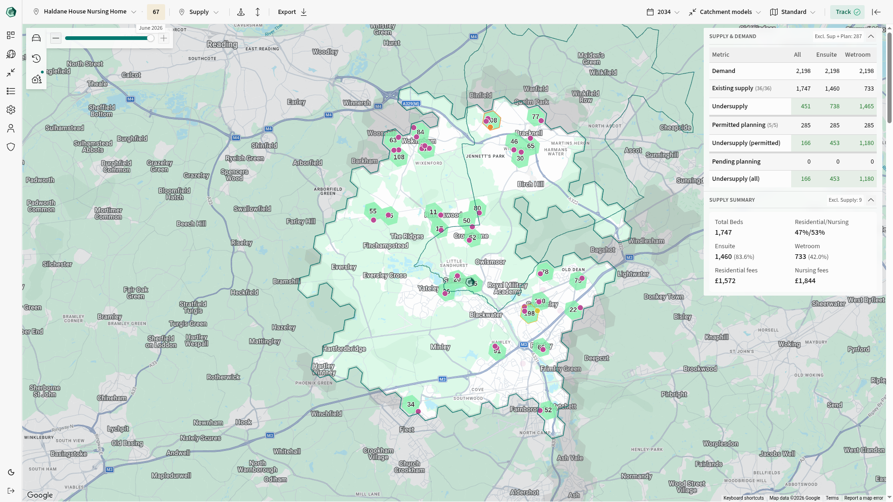

Use the analysis workspace to explore the site, adjust its catchment and review the results.

## Choose a view

Use the selector beside the site name to move between views such as **Demographics**, **House Prices**, **Supply**, **Planning Constraints** and **Staffing/Access**.

The active view controls which figures, tables and map layers appear. The views available to you may vary.

## Set the analysis

Use the controls above the workspace to change:

- **Projection year** sets the year used for projected population figures.
- **Comparison** sets the area, catchment model or target used as a reference.
- **Map style** changes the base map behind your analysis.

These controls change the analysis, not the site's saved location.

## Work with the map

Use the map to explore the site, its catchment and nearby records. Open **Layers** to show or hide the layers available for the current view.

Open **Catchment settings** to change the catchment type and range. You can also edit individual hexes and save useful catchments.

## Read the analysis

The data panels contain the figures, charts and tables for the current view. **Demographics**, for example, can include headline measures, regional comparisons, an age profile and population projections.

The panels update when you change the view, catchment, projection year or comparison. When a figure includes a comparison, PICSy shows the current catchment value alongside the selected reference.

## Export your work

Open **Export** to create a PDF report or download an Excel workbook.

<CardGroup cols={2}>
  <Card title="Configure a catchment" icon="sliders" href="/analysis/configure-a-catchment">
    Choose the catchment type and range for the analysis.
  </Card>
  <Card title="Edit a catchment" icon="pen-to-square" href="/analysis/edit-a-catchment">
    Include or exclude individual hexes and nearby built-up areas.
  </Card>
</CardGroup>

When you are ready to share the results, [export the analysis](/analysis/export).

## Compare supply and demand over time

Add **Supply and demand over time** to an analysis scene. Place it in a half-width or full-width content slot, or in a map overlay. The chart uses the currently selected catchment hexes, including edits. Choose **All beds**, **Ensuite** or **Wetroom** to change the supply line. The chart starts in 2012. With Carehome Tracker access, the supply line shows January stock up to the previous year, reconstructed from the selected homes’ registration periods and recorded bed counts. The historical ensuite and wetroom figures use known counts and estimate missing splits from the age of the home. Gaps indicate unavailable history.

The dashed part of the demand line shows **Estimated historical demand**. Before the published population series begins, PICSy estimates each older age band by running its first ten years of projected growth backwards, then applies standard care home demand. From the reference year onwards it uses the published population growth for each age band.

**Recorded stock** holds the included open homes’ current recorded beds constant for future years. Both supply options show the same history. With Carehome Tracker access, **Trend** starts from the same stock and extends the average rate of bed openings and closures over the last five years in the selected catchment. It estimates the ensuite and wetroom share of those changes. Where the tracker has insufficient history, use **Recorded stock**.

On the **LAD Map Pilot**, the same toggle applies to the selected geography. Historical years retain their observed supply series. **Recorded stock** holds the last observed annual value through future years, and **Trend** shows the pilot’s projected supply. The pilot’s annual stock includes estimates for homes with missing ensuite or wetroom counts. The chart and map use the same choice.
