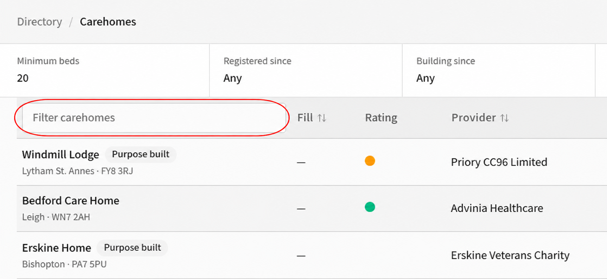

Directories are useful when you want to find a known record, filter a market or inspect an area in more detail.

<Note>
  **Paid add-on: Directories**

  **Planning** and **Developers**, plus enhanced care home details and regional measures, require the relevant **Directories** add-on. The sections and details you see depend on your access.
</Note>

## Choose a directory

1. Open **Directory** from the main navigation.
2. Select the section you want to explore.

The Directory home page shows the sections available to you, along with a quick summary of what each one contains.

| Directory | What you can find |
| --- | --- |
| **Carehomes** | Care homes, including their location, status, capacity and available operating details |
| **Planning** | Care-related planning projects, their status, dates, capacity and developers |
| **Operators** | Providers, brands and the homes connected to them |
| **Developers** | Developers and their planning projects |
| **Built Up Areas** | Settlements and their available local measures |
| **Local Authority Districts** | Districts and their available measures and rankings |
| **Counties** | Counties and their available measures and rankings |
| **Regions** | Regions and their available measures and rankings |
| **Metrics** | The measures available in PICSy, grouped with their descriptions and sources |

## Find a record

Directory pages use a familiar set of controls:

1. Use the filters above the table to narrow the results.
2. Search the table when you know part of a name or address.
3. Select a column heading to change the sort order.
4. Open **Columns** to choose which fields are visible.
5. Select a record name to open its details.

Use **Previous** and **Next** to move through longer result lists. The filters and columns vary by directory, so you only see controls that apply to the records you are browsing.

## Read care home accommodation counts

**Rooms & Facilities** counts bedrooms. **Beds** counts bed places.
For eligible care homes, PICSy can estimate **Wetroom beds** and **En-suite beds**
from registered capacity. The room counts use separate evidence about bedrooms.

## Read a planning project's applications

Open a project and look under **Applications**. Applications for the same property can appear together, each with its own council reference and status.

A matched full or outline application can update the project’s status. For example, a new full application after a refusal can show as **Undecided** while the earlier refusal remains in the history.

On a site with both a care home and housing, care beds come from the care-home part of the proposal. PICSy can estimate the care-bed count when it is missing. Separate housing counts towards senior living when the proposal specifies a qualifying use.

When a later application to convert the whole care site to housing is granted, the project drops out of care planning. While the housing application is pending, the existing care proposal remains eligible and the public project lists its care applications.

If you see **Possible related applications**, check the council record using the reference. PICSy has yet to confirm how these applications relate to the project.

## Read care home extensions in Analysis

Enable **Extensions** in the planning filters to see proposals for existing care homes. **Linked home open** means the existing home is operating. **Opened** means PICSy has evidence that the planning project delivered operating care capacity.

The **Beds** column counts additional places supported by the selected application. PICSy counts one place per explicitly added resident bedroom when the proposal gives a bedroom count. A figure marked **in proposal** is the recorded capacity. A proposal with no verified increase contributes zero beds to planned supply.

## Export a directory

Where **Download CSV** is shown, select it to export the results that match your current search and filters.

Next, [add a site and start an analysis](/get-started/add-your-first-site).
